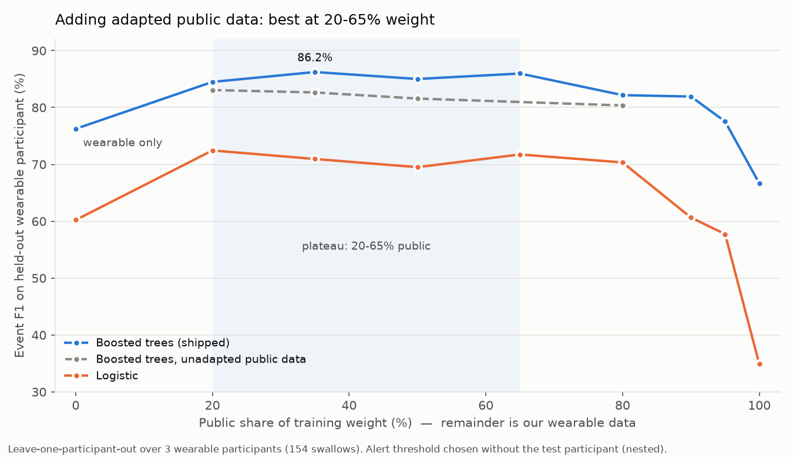

# Wearable + adapted public data (swallow detector)

These swallow detectors are trained on our wearable recordings plus the public Pittsburgh recordings ([Zenodo 4539695](https://zenodo.org/records/4539695)), adapted to look like our device. Every score is measured on **wearable participants the model never trained on**. The public data is only used for training.

**Data:** 3 participants, 14 sessions, 154 reviewed dry swallows (updated 25 Nov 2026 with 5 new sessions).



## Bottom line

| Model (`data_collection/models/mixed/`) | Public / wearable | Nested F1 | Tuned-threshold F1 | Precision | Recall | False alerts/min |
| --- | ---: | ---: | ---: | ---: | ---: | ---: |
| Wearable only (boosted trees) | 0 / 100 | 76.2% | 81.6% | | | 1.57 |
| `mixed_50_50.json` | 50 / 50 | 85.0% | 86.4% | 84% | 89% | 0.93 |
| `mixed_80_20.json` | 80 / 20 | 82.2% | 84.7% | 81% | 88% | 1.11 |
| `mixed_optimal_35_65.json` | 35 / 65 | **86.2%** | **89.7%** | **86%** | **94%** | **0.82** |

> **Superseded:** `mixed_context_35_65.json` is now the recommended model: the same 35/65 mix, but the trees also see the two earlier windows. It scores 90% vs 88% nested F1 on the original 14 sessions and 77% vs 75% on all 24 sessions. See [the public-data gap study](../public_domain_gap/README.md). The numbers in the table above were measured on the 14 sessions available at the time.

- **Nested F1:** the alert threshold is chosen without the test participant. Treat this as the realistic estimate for a new wearer.
- **Tuned-threshold F1:** what the exported model achieves with the mic/IMU agreement check and a threshold chosen on the same pooled folds. It is slightly optimistic.
- **Precision, recall and false alerts** are from the exported model.
- **Per participant** (35/65, tuned): P01 85%, P02 90%, P03 93%. P01 improved from ~67% once their microphone stopped dropping out.
- **`*_logistic.json` twins** are the same data with the original logistic detector. They are clearly weaker: 70–72% nested.

### Prospective check on new sessions

The previous 35/65 model ran **live in Swallow Studio** during P01's new S05 and S06 sessions. It caught **37 of 38 swallows with 5 false alerts in 4 minutes (92.5% F1)**. Replayed offline over all five new sessions, the previous tree models scored **83.5–87.6% F1** before any retraining. P01 was in those models' training data, so this tests new sessions, not a new person.

## Why 35/65

- **It's a plateau, not a peak.** Every split from 20% to 65% public scores 84–86% nested F1. Choosing the split inside each fold from 2 people lands on that plateau, with an estimated 84.6% F1.
- **Your own data needs most of the weight.** Above ~80% public, scores fall, reaching 67% with public data only. This fits domain-adaptation theory (Ben-David et al. 2010): when the two datasets differ, the target data should carry far more weight than its ~5% share of training windows.
- **35% is consistently near the top** in both the nested and the tuned results.

## Does adapting the public data still matter?

| Public share | Adapted (trees, nested F1) | Unadapted (trees, nested F1) |
| ---: | ---: | ---: |
| 20% | 84.5% | 83.1% |
| 35% | 86.2% | 82.6% |
| 50% | 85.0% | 81.6% |
| 80% | 82.2% | 80.4% |

**Yes, but less than before.** With 85 swallows, adaptation was worth 7–14 points. With 154 swallows it's worth 1–4 points for trees and nothing for the logistic model. As our own data grows, the model relies less on the public data matching it exactly. Most of the gain now comes from **having** the public data (+10 points over wearable only), not from adapting it.

## How the adaptation works (`data_collection/adapt_public.py`)

| | Public (raw) | Wearable |
| --- | --- | --- |
| Rates | 4 kHz | mic 44.1 kHz, IMU ~904 Hz (nominal 833) |
| Units | voltage-like | mic PCM counts, accelerometer m/s² |
| Axes | anatomical, gravity removed | sensor X/Y/Z with gravity (mostly on X) |
| Swallow ÷ background loudness | mic 2.3×, accel 1.8× | mic 5.1×, accel 3.4× |
| Swallow label duration | median 0.80 s | median 0.84 s |

The steps:
1. **Resample:** mic to 44.1 kHz PCM, accelerometer to the measured IMU rate.
2. **Axes and gravity:** map up-down→X, side-to-side→Y, front-to-back→Z, then add our gravity vector.
3. **Gain and equaliser:** calibrated in the detector's own feature space until swallow loudness and band shares match ours.
4. **No noise or label changes:** the public background is already noisier, and swallow durations already match.

On public recordings not used for calibration, feature mismatch falls from **0.56 → 0.13** wearable SDs on swallow windows and **0.40 → 0.13** on background windows (`adaptation_check.png`).

**Weighting:** `public_share` is each dataset's share of the training loss. Within each dataset, swallow and background windows are class-balanced, and hard negatives get extra weight. **The sensor-agreement check** (mic-only and IMU-only scores ≥ 0.4) is built into every exported model.

## Limits

- **Three people.** Differences under ~5 points are within noise.
- **Different swallows.** Public swallows are clinical bolus swallows from patients; ours are dry swallows from healthy volunteers.
- **New participants help most.** More participants, and water or food swallows, are the biggest improvements available.

## Reproduce

From the repo root, with `data_collection/requirements-training.txt` installed and `python download_data.py` run:

```sh
python data_collection/check_adaptation.py
python data_collection/train_mixed.py --model trees          # sweep
python data_collection/train_mixed.py                        # logistic sweep
python data_collection/train_mixed.py --model trees --mode control --shares 0.2 0.35 0.5 0.8
python data_collection/train_mixed.py --model trees --mode select-share --shares 0 0.2 0.35 0.5 0.65 0.8
python data_collection/train_mixed.py --model trees --mode export --export mixed_50_50=0.5 mixed_80_20=0.8 mixed_optimal_35_65=0.35
python experiments/plot_mixed_sweep.py
```

The adapted public features are cached in `_cache/adapted_public/`.
