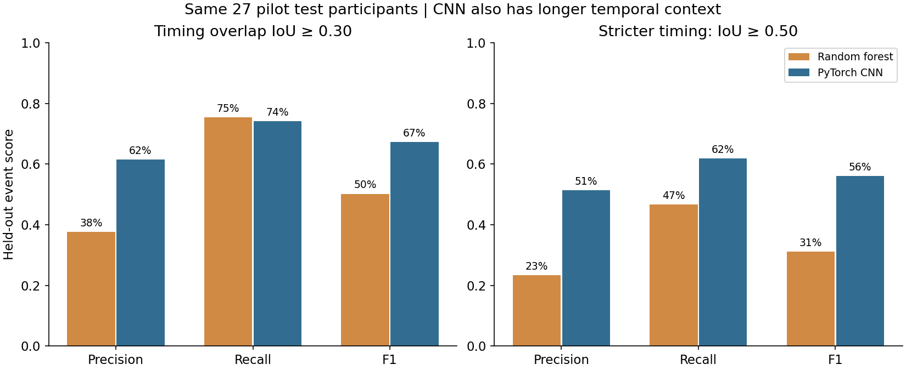
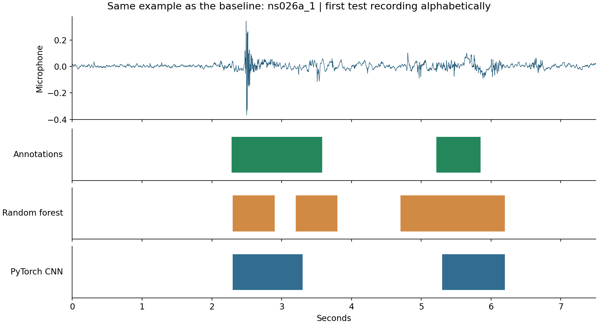
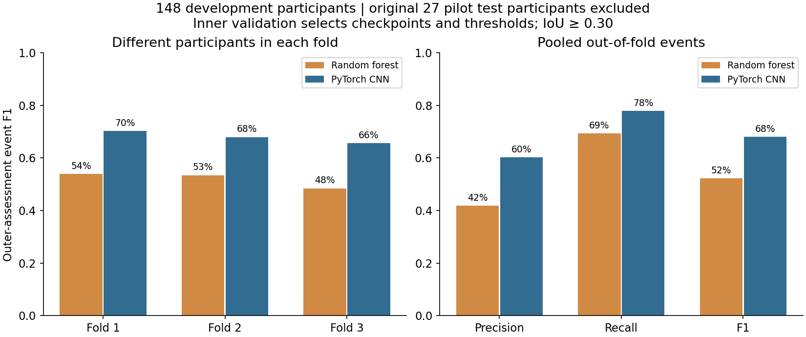
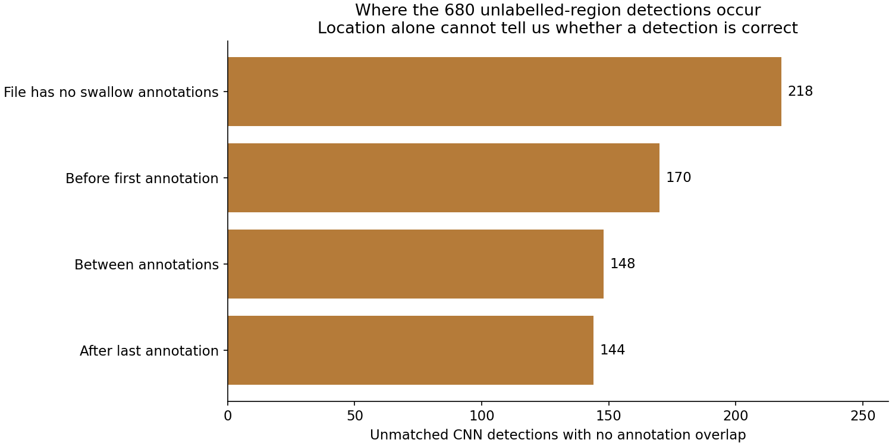
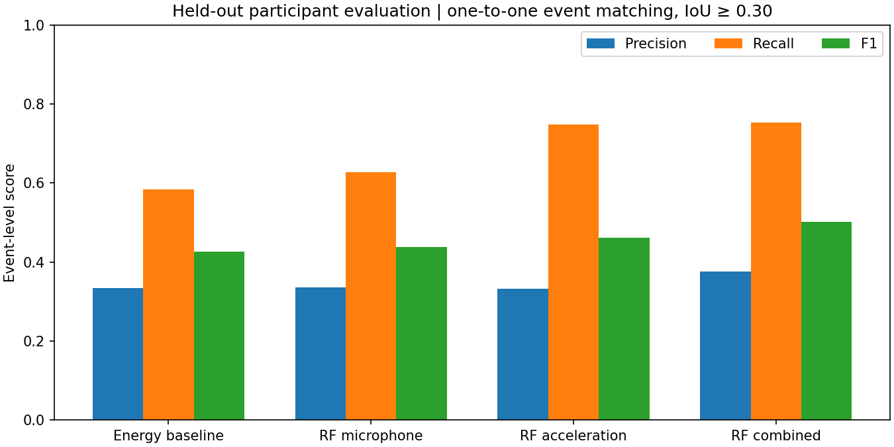
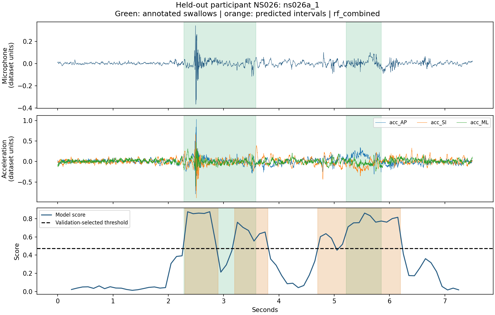
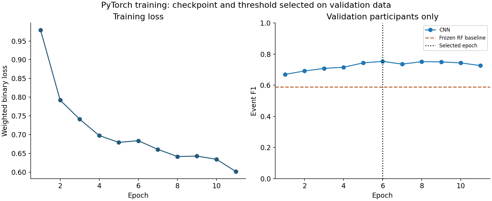
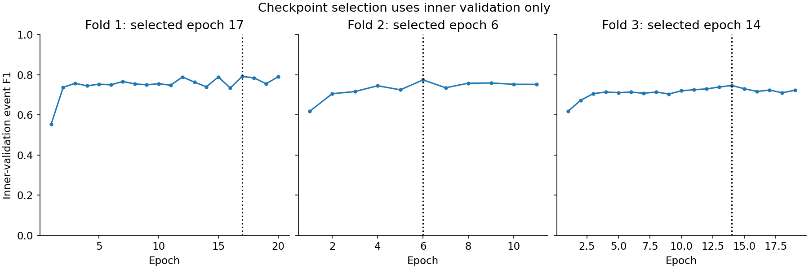
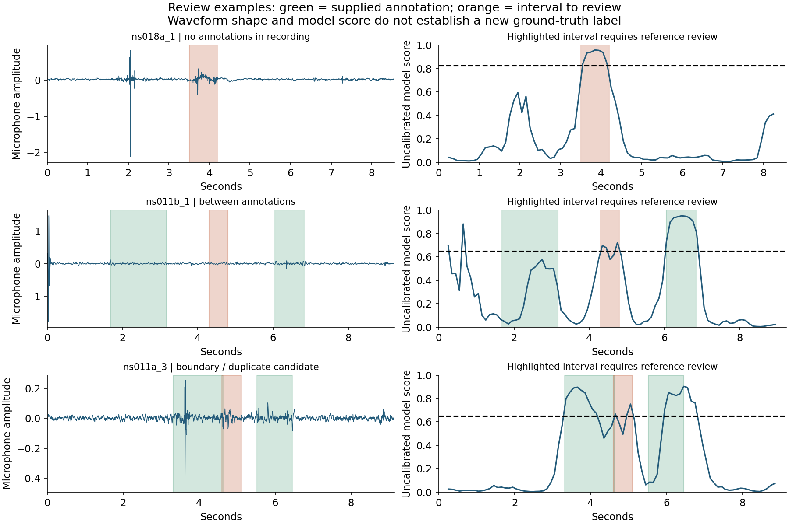

# Images and graphs for the presentation

[Home](../README.md)

All figures below are existing saved experiment outputs. No training or scores were changed during the November 11 cleanup.

## Jump to a figure

| Order | Figure | Use |
| --- | --- | --- |
| 1 | [Model comparison](#figure-1) | Main presentation |
| 2 | [What a prediction looks like](#figure-2) | Main presentation |
| 3 | [Does it hold across participants?](#figure-3) | Main presentation |
| 4 | [Why the annotation issue matters](#figure-4) | Main presentation |
| 5 | [Baseline methods and sensor channels](#figure-5) | Backup |
| 6 | [Original held-out recording](#figure-6) | Backup |
| 7 | [CNN training and checkpoint selection](#figure-7) | Backup |
| 8 | [Training within each development fold](#figure-8) | Backup |
| 9 | [Examples requiring reference review](#figure-9) | Backup |

## 1. Model comparison

[Open full-size image](../experiments/cnn_v1/rf_vs_cnn.png)

On the same 27 held-out participants, the CNN scored 67.3% event F1 versus 50.2% for the random forest, using the supplied annotations and an overlap threshold of 0.30.

## 2. What a prediction looks like

[Open full-size image](../experiments/cnn_v1/example_rf_vs_cnn.png)

This recording shows where each model detected swallows alongside the annotated intervals.

## 3. Does it hold across participants?

[Open full-size image](../experiments/grouped_cv_v1/grouped_validation.png)

Across three development folds, pooled event F1 was 68.0% for the CNN and 52.2% for the random forest. The original 27 test participants were held out of this analysis.

## 4. Why the annotation issue matters

[Open full-size image](../label_review/unlabelled_regions.png)

This plot shows where detections fell outside the supplied annotations. Some may be model errors, while others may be events that were never labelled.

## 5. Baseline methods and sensor channels

[Open full-size image](../results/model_comparison.png)

The baseline compares a simple energy threshold with random forests trained on microphone data, acceleration data, or both.

## 6. Original held-out recording

[Open full-size image](../results/held_out_example.png)

An example from the held-out set shows how the baseline detections line up with the annotated swallows.

## 7. CNN training and checkpoint selection

[Open full-size image](../experiments/cnn_v1/training_curves.png)

Training loss and validation F1 across epochs show how the CNN checkpoint was selected.

## 8. Training within each development fold

[Open full-size image](../experiments/grouped_cv_v1/inner_validation_curves.png)

Each fold used a separate validation set to select its checkpoint and threshold.

## 9. Examples requiring reference review

[Open full-size image](../label_review/review_examples.png)

These examples show where synchronized reference recordings would help clarify what happened.

