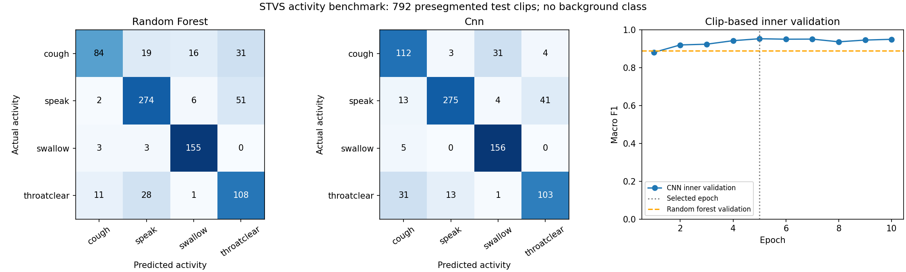

# Four-activity benchmark, v1

This asks whether an already-segmented vibration clip is cough, speech, swallow or throat clearing. It does not detect swallow timing in a continuous recording or diagnose dysphagia.

| Model | Inner validation macro F1 | Supplied test accuracy | Supplied test macro F1 |
| --- | ---: | ---: | ---: |
| random_forest | 88.9% | 78.4% | 76.5% |
| cnn | 95.3% | 81.6% | 79.5% |

Selected on inner validation: **cnn**, CNN epoch 5.

## Audit and protocol

- Original release: 8,208 training and 792 test clips; 6,400 Hz, 4,000 samples per clip (0.625 s).
- Excluded 20 ambiguous training rows across 10 waveform hashes with conflicting activity labels. No replacement labels were invented.
- Found 45 duplicate training rows; eligible duplicates stay in the same inner partition. No exact train/test overlap was found.
- Inner validation is class-stratified and grouped by waveform hash, not by participant. Arrays have no per-row participant IDs.
- The authors describe 12 training and 20 separate test participants. We preserve their supplied test partition; that separation cannot be reconstructed independently from these arrays.
- Both models are trained only on the fitting partition. The CNN checkpoint and model choice use inner validation macro F1. Test evaluation follows freezing both models.
- Random forest uses 22 time/frequency features and 300 trees. The small CNN uses a normalized waveform and temporal convolutions. Neither reproduces the paper ensemble.

## Interpretation

The gap between inner validation and supplied-test performance cautions against relying on clip-based validation alone. Do not describe the inner-validation result as unseen-person performance. The test set contains multiple clips per participant, so clips are not independent patient-level samples.

These results are separate from HRCA event F1. There is no quiet/background class, continuous onset/offset reference, or clinical risk label here. Transfer to our wearable has not been measured. Freeze this test result and use new development data for further choices.

See `audit.json`, `config.json`, `history.json`, `split.json`, `provenance.json` and `metrics.json` for reproducibility. Weights and prediction arrays are generated locally and excluded from Git.
